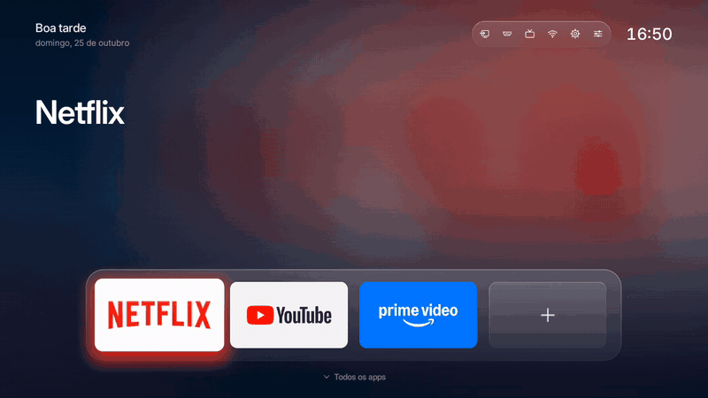
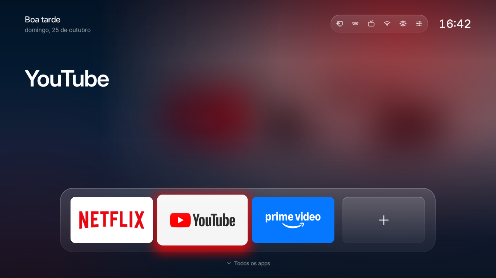
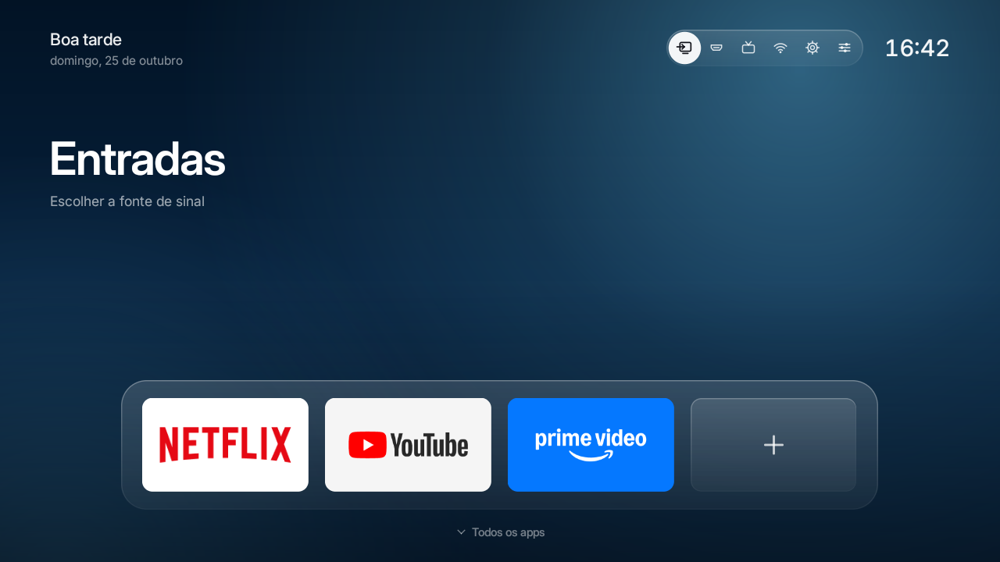
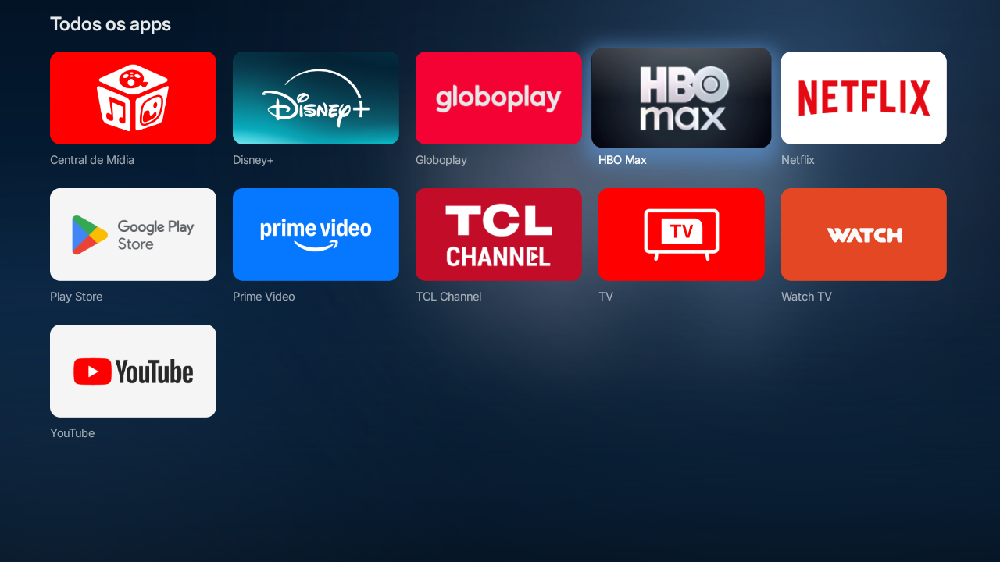

<div align="center">

# Clean TV

**Sua Android TV sem anúncios e com uma tela inicial bonita.**<br>
Pela rede de casa, sem root, e com volta garantida para o estado de fábrica.

Criado por [@MarinelliPedro](https://github.com/MarinelliPedro)

[](https://github.com/MarinelliPedro/clean-tv/actions/workflows/ci.yml)
[](LICENSE)




<sub>Gravado direto de uma TCL Android TV 9 com 1,4 GB de RAM. O gravador da TV captura só ~8 quadros por segundo; ao vivo, o launcher roda a 60.</sub>

</div>

## O que é

Duas peças que trabalham juntas:

| | |
|---|---|
| **`cleantv`**, a ferramenta de terminal | Conecta na TV por ADB na rede local, faz um backup completo, classifica cada pacote e desativa, em lotes pequenos e só com a sua confirmação, o que é anúncio, telemetria ou bloatware. Nada é desinstalado: `cleantv restore` devolve tudo. |
| **Clean TV**, o launcher | Tela inicial minimalista e cinematográfica para TV: dock de vidro com 4 apps, luz na cor da arte do app em foco, fundo com a arte desfocada em movimento lento, grade com "Recentes", atalhos para entradas e HDMI. 130 KB, sem bibliotecas e **sem permissão de internet**. |

Inspirado no conceito de [Gathin23/cleanyourtv](https://github.com/Gathin23/cleanyourtv), com código e identidade visual próprios.

## Destaques

- **Reversível de verdade.** Ponto de restauração antes de qualquer mudança, diário de cada passo, `restore` que confere o resultado e scripts de emergência que funcionam sem Python.
- **Seguro por padrão.** Dry-run primeiro; para aplicar, você digita `APLICAR`. Pacote desconhecido = não tocar. Configurações, Play Store, rede, teclado, controle, chipset e atualizações ficam numa lista de proteção no código.
- **Lotes com rede de segurança.** Depois de cada lote, a ferramenta confere a saúde da TV e desfaz o lote se algo der errado. Se o Wi-Fi cair no meio, para com segurança e continua com `resume`.
- **Troca de tela inicial sem susto.** O launcher novo é instalado, aberto e validado antes; o original só é desativado depois, e volta na hora se o botão HOME falhar.
- **Depois de atualizar a TV,** `cleantv check` mostra o que a atualização reativou e reaplica só isso.
- **Feito para TV fraca.** O launcher desenha o fundo em duas camadas e roda a ~9 ms por quadro numa TCL de entrada.
- **Testado sem TV.** Uma TV simulada imita as respostas reais do Android e injeta falhas (queda de rede, launcher que trava, TCL que recusa instalação). Mais de 160 testes.

## Telas

<table>
  <tr>
    <td></td>
    <td></td>
    <td></td>
  </tr>
  <tr>
    <td align="center"><sub>Dock: a luz segue a cor de cada app</sub></td>
    <td align="center"><sub>Atalhos: entradas, HDMI, TV ao vivo, rede</sub></td>
    <td align="center"><sub>Todos os apps, com rolagem por página</sub></td>
  </tr>
</table>

## Começo rápido

```powershell
git clone https://github.com/MarinelliPedro/clean-tv.git
cd clean-tv
python -m cleantv doctor                               # confere Python, adb e rede
python -m cleantv run --simulate tcl-google-tv         # experimente numa TV simulada
python -m cleantv run --ip 192.168.0.40                # na sua TV: plano em dry-run
python -m cleantv run --ip 192.168.0.40 --apply        # aplica, com confirmação
python -m cleantv restore --ip 192.168.0.40            # desfaz tudo
```

O APK pronto do launcher está em [Releases](https://github.com/MarinelliPedro/clean-tv/releases); a ferramenta instala e valida ele por você (`cleantv launcher`).

## O que a ferramenta faz e o que não faz

| Faz | Não faz |
|---|---|
| Conecta pela rede local (ADB, porta 5555) depois de você confirmar o IP e a TV | Não usa ADB pela internet: só IPs privados (10.x, 172.16–31.x, 192.168.x) |
| Grava um backup completo antes de qualquer mudança | Não desinstala pacotes do sistema nem apaga dados |
| Classifica cada pacote e mostra um plano com motivo, risco e como desfazer | Não faz root, não desbloqueia bootloader, não altera firmware, não contorna DRM |
| Desativa só o que você aprovou, com `pm disable-user`, em lotes pequenos | Não toca em pacote sem regra (desconhecido = não tocar) |
| Troca o launcher em ordem segura e reverte sozinha se o HOME falhar | Não desativa Configurações, Play Store, rede, teclado, controle, chipset nem o assistente de configuração |
| Gera relatório, scripts de restauração e oferece desligar o ADB no fim | Não suporta Samsung (Tizen), LG (webOS), Roku nem Fire TV |

## Requisitos

- Computador com Windows 10/11, macOS ou Linux, **na mesma rede** da TV.
- Python 3.11 ou mais novo (sem dependências extras).
- ADB (Google Platform Tools):
  - Windows: `winget install Google.PlatformTools`
  - macOS: `brew install android-platform-tools`
  - Linux: pacote `android-tools-adb` / `android-tools`
- Uma TV com **Android TV** ou **Google TV** que seja sua (ou com autorização explícita do dono).

## Instalação

```powershell
git clone https://github.com/MarinelliPedro/clean-tv.git
cd clean-tv
python -m cleantv doctor          # confere Python, adb e rede
```

Opcional, para ter o comando `cleantv` direto e rodar os testes:

```powershell
python -m pip install -e ".[dev]"
python -m pytest
```

## Preparar a TV (opções do desenvolvedor)

1. **Liberar as opções do desenvolvedor**
   - Google TV: Configurações → Sistema → Sobre → clique 7 vezes em **Build do SO do Android TV**.
   - Android TV (interface antiga): Configurações → Preferências do dispositivo → Sobre → clique 7 vezes em **Build**.
2. **Ativar a depuração**: Configurações → Sistema (ou Preferências do dispositivo) → **Opções do desenvolvedor** → ative **Depuração USB**. Em algumas TVs (incluindo várias TCL) existe também **Depuração de rede** ou **ADB pela rede**: ative também.
3. **Anotar o IP da TV**: Configurações → Rede e Internet → sua rede.
4. Na primeira conexão, a TV mostra **"Permitir depuração?"**. Marque **Sempre permitir deste computador** e confirme.

## Uso

Todos os comandos podem ser rodados com `python -m cleantv ...` (ou só `cleantv ...` se você instalou com pip).

### 1. Experimentar sem TV (simulação)

```powershell
python -m cleantv run --simulate tcl-google-tv            # dry-run
python -m cleantv run --simulate tcl-google-tv --apply    # aplica na TV simulada
python -m cleantv restore --simulate tcl-google-tv        # desfaz
python -m cleantv sim-reset tcl-google-tv                 # reinicia a TV simulada
```

Perfis simulados: `tcl-google-tv` (Google TV, Android 11) e `android-tv-generic` (Android TV 9) são **sintéticos**. `tcl-uniontv-atv9` é uma cópia do inventário real de uma TCL Android TV 9 (com número de série fictício).

### 2. Inventário da sua TV (somente leitura)

```powershell
python -m cleantv inventory --ip 192.168.0.40 --brand TCL --model 55C735
```

Lê a identidade da TV, pede confirmação, grava o **ponto de restauração original** e mostra a classificação de todos os pacotes. Este comando **não altera nada**: todas as leituras passam por um transporte que bloqueia qualquer escrita.

Sem `--ip`, a ferramenta oferece procurar a TV na sua rede (porta 5555, só na sua /24).

### 3. Plano em dry-run

```powershell
python -m cleantv run --ip 192.168.0.40 --brand TCL
```

Fluxo guiado: autorização → marca/modelo → rede → confirmação do IP → conexão → identidade → backup → classificação → suas escolhas (assistente de voz, Chromecast, atualizações, protetor de tela, itens recomendados e opcionais, apps a esconder, 4 apps do dock, troca de launcher) → plano → comandos que **seriam** enviados. Nada é alterado.

### 4. Aplicar

```powershell
python -m cleantv run --ip 192.168.0.40 --brand TCL --apply
```

Igual ao dry-run, mas no fim você precisa **digitar `APLICAR`**. As mudanças vão em lotes (padrão: 5 pacotes, ajustável com `--batch-size`). Depois de cada lote, a ferramenta checa a saúde da TV e pergunta se está tudo funcionando; se você disser que não, ela desfaz o lote.

### 5. Se a conexão cair

```powershell
python -m cleantv resume --ip 192.168.0.40     # continua de onde parou
python -m cleantv restore --ip 192.168.0.40    # ou desfaz tudo
```

### 6. Restaurar

```powershell
python -m cleantv restore --ip 192.168.0.40             # mostra o plano e pede confirmação
python -m cleantv restore --ip 192.168.0.40 --dry-run   # só mostra
```

Reativa tudo que estava ativo no ponto de restauração original, devolve a tela inicial original e, se você quiser, remove **apenas** o launcher do Clean TV. Funciona mesmo sem os diários de execução. No fim, a ferramenta lê a TV de novo e confere se ela voltou ao estado do backup.

### 7. Launcher Clean TV

```powershell
.\launcher\build.ps1                                       # compila (veja launcher/README.md)
python -m cleantv launcher --ip 192.168.0.40               # dry-run
python -m cleantv launcher --ip 192.168.0.40 --apply       # instala como app; HOME continua o original
python -m cleantv launcher --ip 192.168.0.40 --apply --set-home                   # vira a tela inicial
python -m cleantv launcher --ip 192.168.0.40 --apply --set-home --disable-stock   # e desativa o original
```

Em algumas TVs (como a TCL Android TV 9 testada) o launcher original declara prioridade de sistema no HOME: aí o Android só aceita outro launcher com `--disable-stock`. A ferramenta detecta isso e avisa.

Para atualizar o launcher depois de recompilar, rode o mesmo comando com `--apply --set-home`. Se a versão nova não abrir, a ferramenta reativa na hora o launcher original que estava desativado, para a TV nunca ficar sem tela inicial. O dock escolhido no `run` é enviado ao launcher automaticamente (ou use `--dock pacote1,pacote2`). Prints das telas: [launcher/app/src/test/snapshots/images](launcher/app/src/test/snapshots/images).

### 8. Depois de atualizar a TV

```powershell
python -m cleantv check --ip 192.168.0.40           # só lê e mostra o que mudou
python -m cleantv check --ip 192.168.0.40 --apply   # reaplica o que voltou (pede APLICAR)
```

Atualizações de sistema costumam reativar pacotes e às vezes devolvem a tela inicial original. O `check` compara o que a ferramenta aplicou, o ponto de restauração original e o estado atual da TV, e mostra:

- se o sistema da TV foi atualizado desde o backup;
- pacotes desativados pela ferramenta que voltaram (e os que as regras de hoje protegem, que não são reaplicados);
- se o launcher original voltou ou se o botão HOME deixou de abrir o Clean TV;
- pacotes novos que a atualização trouxe e que as regras sugerem revisar (o `check` nunca os desativa; use `run`).

Com `--apply`, ele reaplica só o que voltou, pelo mesmo caminho seguro do `run`: lotes, verificação, rollback e diário. Código de saída: `0` tudo em ordem, `4` algo voltou (útil em scripts agendados). Depois de um `restore`, o `check` não propõe nada.

### 9. Encerrar

```powershell
python -m cleantv finish --ip 192.168.0.40
```

Desliga a depuração ADB na TV (também oferecido no fim do `run --apply`). Para usar a ferramenta de novo, reative nas Opções do desenvolvedor.

### Opções úteis

| Opção | Para quê |
|---|---|
| `--data-dir PASTA` | onde ficam backups, diários, relatórios e logs (padrão `~/.cleantv`, ou a variável `CLEANTV_HOME`) |
| `--adb CAMINHO` | caminho do adb, se ele não for encontrado sozinho |
| `-v` | mostra no terminal cada comando enviado à TV |
| `--rules-dir PASTA` | regras extras `.toml` (por exemplo, do seu modelo) com prioridade maior |
| `--launcher-apk ARQUIVO` | APK do launcher (padrão: `launcher/dist/clean-tv-launcher.apk`) |
| `--no-batch-confirm` | não pergunta entre os lotes |
| `--max-batches N` | aplica até N lotes e pausa; confira a TV e continue com `resume` |

## Como a ferramenta decide

Cada pacote recebe uma categoria: **anúncios/conteúdo patrocinado**, **telemetria/rastreamento**, **possível bloatware**, **manter**, **sistema crítico** ou **não classificado (não tocar)**.

- Só entra no plano automaticamente o que tem regra com confiança **alta**. Confiança média ou baixa aparece como **opcional**: você precisa marcar.
- Assistente de voz, Chromecast e protetor de tela só são desativados se você responder que não quer manter.
- Pacotes essenciais ficam numa lista de proteção **no código** ([cleantv/rules/safety.py](cleantv/rules/safety.py)), que nenhum arquivo de regra derruba sem uma marcação explícita e sua confirmação digitada.
- O launcher original só é desativado depois que o novo foi instalado, abriu e assumiu o botão HOME. Se o HOME cair em outro lugar (por exemplo no assistente de configuração do Google TV), o original é reativado na hora.

As regras ficam em [cleantv/rules/data/](cleantv/rules/data/). Detalhes em [docs/ARCHITECTURE.md](docs/ARCHITECTURE.md).

## Compatibilidade

Android TV e Google TV com Android 8 ou mais novo. As regras genéricas do Google valem para todas.

| Testado em TV real | Resultado |
|---|---|
| TCL UnionTV (Android TV 9, chipset Realtek, 1,4 GB) | 16 pacotes desativados em 4 lotes, launcher Clean TV como tela inicial, reinício conferido, `check` em ordem |

As regras de Xiaomi, Sony, Hisense e Skyworth ainda não foram validadas: nelas, pacotes do fabricante ficam como "não tocar". Tabela completa e como contribuir com regras do seu modelo: [docs/COMPATIBILITY.md](docs/COMPATIBILITY.md).

## Riscos

Leia antes de aplicar:

- **Garantia e suporte.** Mudar o software da TV pode afetar garantia ou atendimento do fabricante. O projeto é oferecido sem garantia.
- **Recursos que somem.** Desativar o Assistente tira o botão de voz; desativar o Chromecast tira a transmissão do celular; desativar o modo ambiente muda o protetor de tela. O plano mostra o risco de cada item.
- **Atualizações de firmware** podem reativar pacotes e devolver o launcher original. Rode `cleantv check`.
- **ADB pela rede é texto puro.** Use só em rede doméstica confiável e desligue a depuração no fim. Se a TV tiver `ro.adb.secure=0`, qualquer aparelho da rede consegue um shell; a ferramenta avisa.
- **Regras não validadas.** Até a sua marca/modelo ser validada, só valem as regras genéricas, e pacotes do fabricante ficam como "não tocar".
- **Algumas TCL recusam launchers de terceiros.** Nesse caso, a troca de launcher para na instalação e nada mais muda.

## Recuperação

Do mais simples ao último recurso:

1. `python -m cleantv restore --ip <IP>`: restaura e confere.
2. Scripts de emergência, sem Python, em `~/.cleantv/devices/<id-da-tv>/`: `restaurar.cmd` (Windows) ou `sh restaurar.sh` (macOS/Linux). Eles são regravados a cada lote.
3. Manual, pacote por pacote (o relatório traz o comando de cada um):
   ```
   adb connect <IP>:5555
   adb -s <IP>:5555 shell pm list packages -d          # lista o que está desativado
   adb -s <IP>:5555 shell pm enable <pacote>
   adb -s <IP>:5555 shell cmd package set-home-activity --user 0 <launcher/atividade>
   ```
4. Último recurso: **restauração de fábrica** da TV. O estado de "desativado" fica nos dados do usuário, então um reset de fábrica reativa tudo (mas apaga apps e logins).

Mais casos em [docs/TROUBLESHOOTING.md](docs/TROUBLESHOOTING.md).

## Estrutura do projeto

```
cleantv/        ferramenta de terminal (Python, sem dependências)
  rules/data/   regras por marca (.toml): é aqui que entram novos modelos
  adb/fake.py   TV simulada usada nos testes
tests/          testes unitários e simulados (pytest)
launcher/       launcher Android (Kotlin, sem bibliotecas) e prints das telas
docs/           arquitetura, plano, compatibilidade, troubleshooting
```

## Testes

```powershell
python -m pytest
```

Os testes rodam contra a TV simulada (`cleantv/adb/fake.py`), que imita as saídas reais do Android e injeta falhas: queda de Wi-Fi no meio de um lote, pacote protegido, launcher que trava, TCL que recusa instalação e setupwraith tomando o HOME. Eles cobrem dry-run sem escrita, aplicação, retomada, rollback por lote, ida e volta completa de restauração e a execução dos scripts de emergência.

O launcher tem testes de lógica e prints gerados pelo Paparazzi (sem emulador): veja [launcher/README.md](launcher/README.md).

## Contribuir

Tem uma TV diferente? A contribuição mais valiosa é um inventário somente leitura e regras para o seu modelo. O passo a passo está em [CONTRIBUTING.md](CONTRIBUTING.md), e o [modelo de issue "Nova TV"](https://github.com/MarinelliPedro/clean-tv/issues/new?template=nova-tv.yml) pede só o necessário.

Use a ferramenta apenas em TVs suas ou com autorização do dono. Veja [SECURITY.md](SECURITY.md).

## Créditos

- Autor: [@MarinelliPedro](https://github.com/MarinelliPedro).
- Conceito: [Gathin23/cleanyourtv](https://github.com/Gathin23/cleanyourtv).
- Fonte [Inter](https://rsms.me/inter/), de Rasmus Andersson (SIL Open Font License 1.1).
- Princípios de design das diretrizes de tvOS e das palestras de movimento da WWDC, aplicados com identidade própria. Nenhum asset, logotipo ou fonte da Apple é usado.

## Licença

[MIT](LICENSE). A fonte Inter, incluída no launcher, segue a [SIL OFL 1.1](launcher/app/src/main/assets/licenses/Inter-OFL.txt).

---

<details>
<summary><b>English summary</b></summary>

**Clean TV** debloats Android TV / Google TV over your local network (ADB, no root) and replaces the cluttered home screen with a minimal, cinematic launcher.

- Everything is reversible: a full restore point is saved first, packages are only disabled (`pm disable-user`, never uninstalled) and `cleantv restore` brings the TV back and verifies it.
- Dry-run by default; applying requires typing a confirmation word. Unknown packages are never touched; critical ones are hard-protected in code.
- Small batches with health checks and automatic rollback; safe stop and `resume` if Wi-Fi drops.
- `cleantv check` detects what a firmware update re-enabled and re-applies only that.
- The launcher is 130 KB, Kotlin with no libraries and no internet permission, tuned for low-end TVs (~9 ms per frame on a 1.4 GB TCL).

The interface and docs are in Brazilian Portuguese. Contributions of rules for new TV models are welcome (see CONTRIBUTING.md).

</details>
